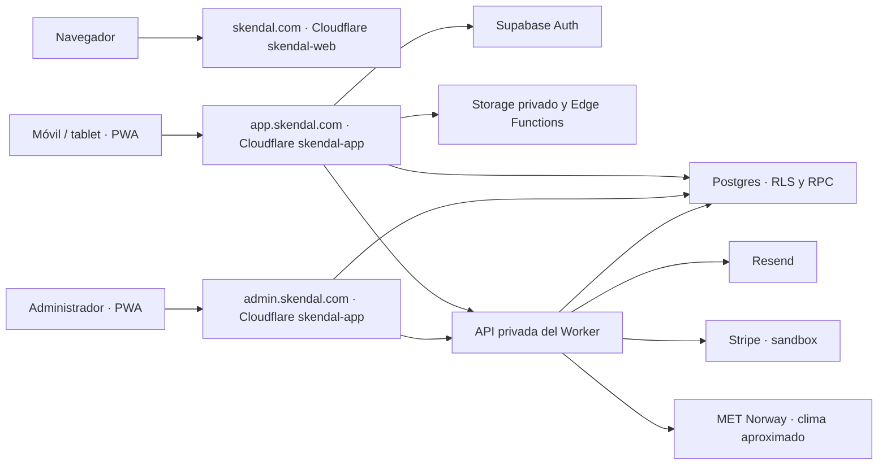

# Arquitectura de Skendal

Inventario contrastado con el repositorio y las conexiones de GitHub, Cloudflare y Supabase el 16 de noviembre de 2026. No contiene credenciales. Los permisos del hogar y de administración son distintos de los permisos para desarrollar o desplegar.

## Código y cuentas

El repositorio público es [HumbeMilano/codebase-revival](https://github.com/HumbeMilano/codebase-revival), propiedad de `HumbeMilano`, accesible mediante la conexión GitHub «milano». La rama principal es `main`. Los nombres históricos `codebase-revival` y `homehub` permanecen en partes del código; la marca pública es Skendal.

Cloudflare utiliza la conexión «Skendal app»; Supabase y Resend utilizan las conexiones «Skendal». Los correos de acceso de las personas y las claves de infraestructura no forman parte de este documento. GitHub no es el proveedor de inicio de sesión de las familias.

## Despliegues actuales

| Dirección                   | Función                                                                 | Alojamiento                                                                                       |
| --------------------------- | ----------------------------------------------------------------------- | ------------------------------------------------------------------------------------------------- |
| `https://skendal.com`       | Web pública, presentación, planes y recursos de marca                   | Cloudflare Worker `skendal-web`, archivos de `site/`                                              |
| `https://app.skendal.com`   | App del hogar, móvil y tablet, instalable como PWA                      | Cloudflare Worker `skendal-app`, SPA de `dist/` y API de `workers/app.ts`                         |
| `https://admin.skendal.com` | Consola maestra de cuentas, hogares y negocio, instalable como otra PWA | El mismo Worker `skendal-app`, con entrada, iconos, manifest, sesión y caché separados por origen |

La separación de dominios ayuda a separar instalaciones y sesiones. La autorización administrativa se comprueba además en el backend; el dominio por sí solo no concede acceso.

## Aplicación

- React 19, TypeScript y TanStack Router; Vite genera una SPA estática. No necesita un servidor SSR ni un proceso Node permanente.
- Tailwind CSS, componentes shadcn/Radix e iconos Lucide. El dashboard conserva una cuadrícula de tres columnas y preferencias por cuenta o por miembro de tablet.
- Los manifests y service workers permiten instalar la app y el administrador de forma independiente. La caché conserva el shell y los archivos públicos, separados de los datos privados de cada hogar.
- Compras utiliza IndexedDB y una cola durable por cuenta/hogar/miembro. Se guardan operaciones y se sincronizan con recibos idempotentes y revisión de conflictos. Otras secciones requieren conexión.
- El orden de compras y las sugerencias se calculan en el dispositivo con productos de la lista seleccionada. Reutilizar un producto marcado lo deja pendiente con su ID y antigüedad originales.

## Backend y seguridad

El proyecto activo de Supabase es **`skendal-homehub`**, referencia **`rwbeiestzyzceramgtdw`**, en **`us-east-1`**, con PostgreSQL 17 administrado. No es el proyecto anterior `HomeHubV2` ni el backend antiguo de Lovable.

Supabase proporciona:

- Auth para las cuentas, confirmación y recuperación por correo y passkeys.
- Postgres para hogares, miembros, tareas, listas/productos, agenda, notas, finanzas, preferencias y operaciones del negocio.
- RLS y RPC para comprobar hogar, identidad, rol, suspensión y revisiones. Las operaciones de miembros y las finanzas se validan en el servidor.
- Storage privado para imágenes. Las Edge Functions de fotos y avatares entregan acceso temporal después de validar el hogar.
- Realtime para cuentas personales y refrescos limitados para tablets vinculadas.

La tablet se vincula con un QR de la app aprobado por un adulto autenticado con passkey. Recibe un token revocable y usa PIN por miembro. La autorización financiera es temporal, vinculada a la sesión o dispositivo y conservada solo en memoria. Las contraseñas no son los PIN de la tablet.

La administración del negocio usa un rol protegido `platform_admin`, separado del rol adulto de una familia. Las cuentas de hogar no obtienen ese rol por ser adultas.

## Integraciones

| Servicio       | Uso                                                                                                   |
| -------------- | ----------------------------------------------------------------------------------------------------- |
| Cloudflare     | DNS, HTTPS, archivos estáticos y API del Worker para invitaciones, vinculación, clima y suscripciones |
| Supabase       | Identidad, base de datos, permisos, almacenamiento y funciones de acceso a imágenes                   |
| Resend         | SMTP de confirmación/recuperación e invitaciones; subdominio de envío `mail.skendal.com`              |
| Stripe         | Checkout, portal y eventos de suscripción; preparación en sandbox, sin activar cargos reales          |
| MET Norway     | Clima a partir de la zona aproximada de la conexión                                                   |
| GitHub Actions | Tipado, tests, lint, formato, build, auditoría, navegador/PWA, SQL desechable y web pública           |

Las claves secretas se mantienen en el servidor y en la configuración de los proveedores. El navegador recibe únicamente la URL y clave publicable de Supabase. Una publicación debe conservar los bindings, secretos y límites existentes del Worker.

## Desarrollo y publicación

`bun.lock` y Bun 1.4.3 fijan el entorno de instalación. El frontend vive en `src/`; el backend HTTP de Cloudflare en `workers/`; funciones y migraciones de Supabase en `supabase/`; la web pública en `site/`; marca en `branding/`; borradores legales en `legal/`.

`bun run build` genera `dist/` y `worker-dist/`. `bun run build:site` prepara la web pública. `wrangler.jsonc` y `wrangler.site.jsonc` describen los dos Workers. GitHub Actions comprueba los cambios; actualmente publicar requiere un despliegue explícito mediante una conexión autorizada a Cloudflare. Una CI verde por sí sola no publica la app ni verifica el uso físico de un iPhone/iPad.

Se conservan los commits publicados y el historial heredado de Lovable. **La ejecución y el alojamiento actuales funcionan sin Lovable.** Los archivos históricos de Drizzle no son un esquema declarativo que deba aplicarse sobre la base real; las actualizaciones usan migraciones SQL revisadas.

La infraestructura está diseñada para los planes Free y sus cuotas. La renovación del dominio se paga por separado. Los límites comerciales y los cobros reales permanecen sin activar durante la preparación; la constitución de la empresa, documentos definitivos y apertura comercial siguen pendientes del propietario.

Configuración y procedimientos: [Producción](production.md). Trabajo pendiente: [roadmap](../roadmap.md) y [M1 #34](https://github.com/HumbeMilano/codebase-revival/issues/34).
