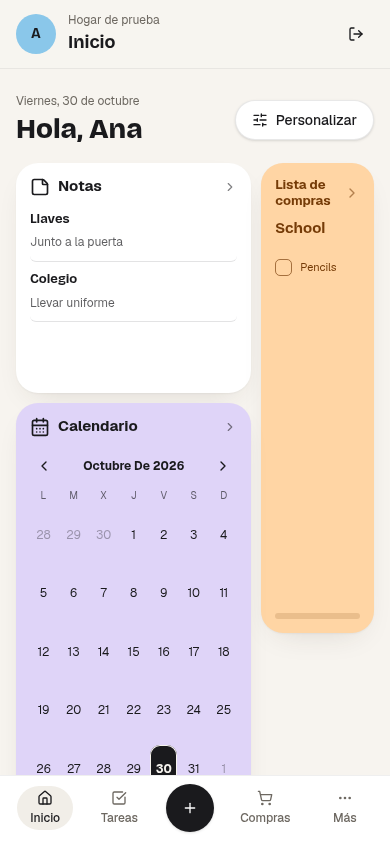
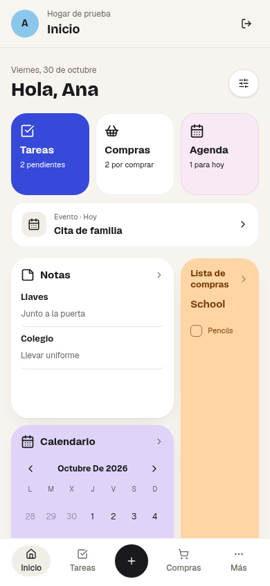

# Pulido visible del inicio y la navegación

30 de octubre de 2026. Seguimiento: [#37](https://github.com/HumbeMilano/codebase-revival/issues/37), [#38](https://github.com/HumbeMilano/codebase-revival/issues/38) y [M1 #34](https://github.com/HumbeMilano/codebase-revival/issues/34).

El cambio anterior de valores iniciales solo afectaba a cuentas sin diseño guardado. Por eso un usuario existente podía seguir viendo el mismo inicio. Esta entrega añade una cabecera compacta para todas las cuentas personales en teléfono, conservando los widgets y sus preferencias.

| Antes                                                                | Después                                                             |
| -------------------------------------------------------------------- | ------------------------------------------------------------------- |
|  |  |

Capturas a 390 × 844 CSS px de un hogar sintético con el mismo diseño guardado. No contienen fotografías ni datos privados del propietario. La captura anterior corresponde a los archivos publicados antes de este cambio; los resultados de publicación se registran en los issues.

## Inicio personal

Tareas muestra las pendientes del día, incluyendo las vencidas que siguen abiertas. Compras cuenta solo productos sin marcar de listas activas. Agenda resume el día y ofrece la próxima entrada. Los datos financieros requieren el mismo permiso que el calendario y las finanzas; un miembro sin permiso no los ve ni provoca sus lecturas.

Los accesos vacíos llevan a los formularios reales, sin crear registros automáticamente. La cabecera se oculta mientras se personaliza y no aparece en las tablets compartidas. Cambiar el ancho o entrar/salir de edición conserva los tamaños y posiciones guardados. No cambia el catálogo, no guarda contenido en preferencias ni añade recorridos o carteles de funcionamiento.

## Selección de registros

- Elegir una lista, abrir una nota, seleccionar un día o abrir una entrada del calendario actualiza su referencia en la URL. Atrás, Adelante y recarga recuperan ese destino; cerrar un editor elimina su intención de edición.
- La URL contiene exclusivamente la sección y un identificador validado. No incluye títulos, importes ni borradores, conserva los parámetros de invitación/recuperación y rechaza fechas inexistentes o referencias que no corresponden a esa sección.
- Un registro inexistente o archivado muestra que ya no está disponible y permite volver al listado. Nunca sustituye una referencia explícita por otra lista o nota.
- Las compras sin red abren la misma lista desde IndexedDB. La selección se conserva al reconectar y cada producto sigue ligado a su hogar/lista originales. Una confirmación tardía no borra el texto de otro producto escrito en una lista diferente.
- Una respuesta tardía al guardar una nota o evento no cierra el registro abierto después. Refrescar los datos del mismo registro tampoco reemplaza el borrador que está editando el usuario.

## Verificación y límites

`e2e/mobile-polish.spec.ts` comprueba el inicio con preferencias guardadas a 320/390/412/768/1024 px, destinos de las acciones, permisos, notas, calendario, referencias no disponibles y recarga real sin conexión. Las pruebas de planner y compras comprueban respuestas tardías; las de navegación validan fechas y referencias. Las suites anteriores cubren doce tamaños, grip, scroll, cola durable y PWA separadas.

Las capturas y las pruebas usan Auth y datos sintéticos; no acreditan gestos físicos, VoiceOver/TalkBack ni comprensión con hogares reales. Esas comprobaciones permanecen en #37/#38/#48. La empresa, documentos definitivos y cobros reales siguen pendientes de sus condiciones previas; esta entrega no cambia planes ni activa pagos.
